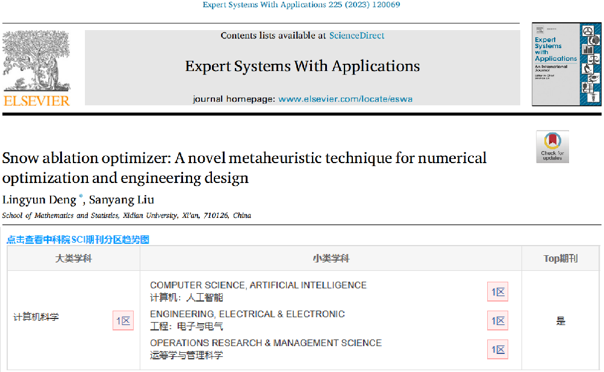
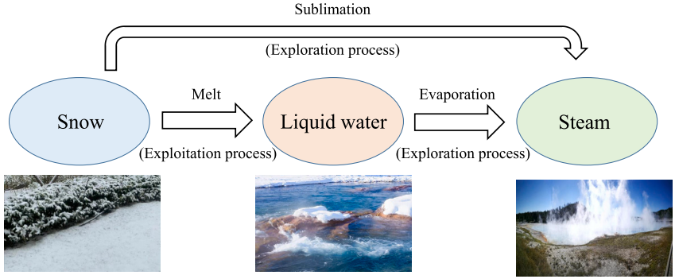
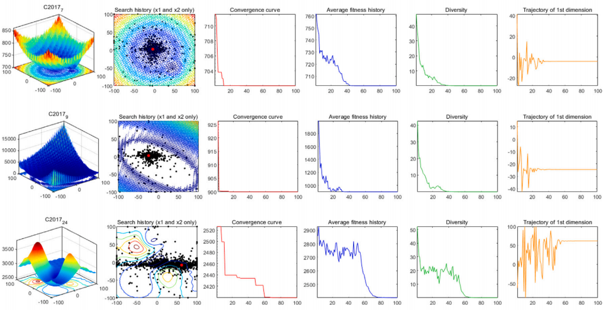
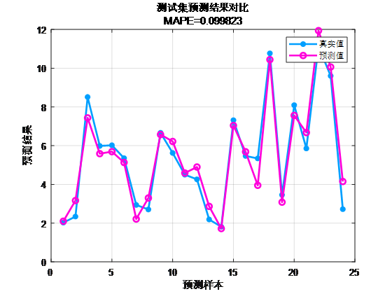
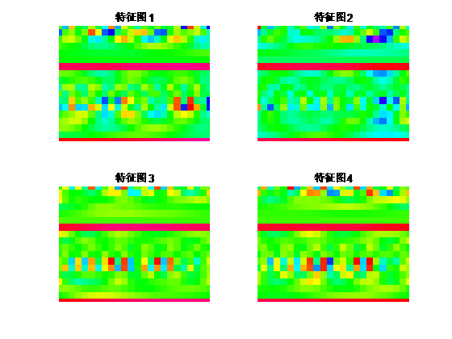
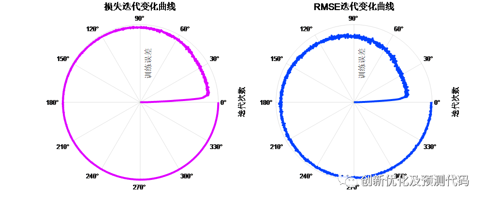

# 2023 Institute of Electronics, Chinese Academy of Sciences: Snowmelt Optimization SAO-CNN-BiGRU-Attention Fusion Attention Mechanism Prediction Program Code! Run directly.

Applicable Platform: Matlab2023 version and above.
The Snow Ablation Optimizer (SAO), published in June 2023 in the top journal of SCI, Chinese Academy of Sciences, "Expert Systems with Applications", is a novel algorithm proposed at that time. There are no existing literatures applying this algorithm yet, so it's first come, first served! Seize this innovation opportunity!
We utilized SAO to optimize the hyperparameters in our CNN-BiGRU-SelfAttention temporal and spatial feature combination - fused multi-head self-attention mechanism regression prediction program code.
This paper introduces a novel metaheuristic algorithm named Snow Ablation Optimizer (SAO) for numerical optimization and engineering design. The SAO algorithm mainly simulates the sublimation and melting behaviors of snow, achieving a balance between development and exploration in the solution space and avoiding premature convergence.
Through using 29 typical CEC2017 unconstrained benchmark problems and 22 real constrained optimization problems from CEC2020 for validation, it was also compared with traditional AO, MVO, EO, AVOA, HHO, PSO-sono, SHADE, LSHADE-SPACMA, etc., demonstrating the optimization capability of SAO. Moreover, to further verify its advantages, the author applied SAO to extract core parameters of photovoltaic systems. The results showed that the developed SAO performed better than other advanced optimization methods.
The innovation points of SAO algorithm are mainly reflected in the following aspects:
Dual population mechanism: SAO algorithm introduces a dual population mechanism, dividing the population into two subpopulations responsible for exploration and exploitation respectively, to achieve a balance in the solution space.
Brownian motion exploration strategy: During the exploration phase, the algorithm employs Brownian motion to simulate the irregular motion of steam, enabling search agents to exhibit a highly dispersed characteristic and thus explore potential regions.
Day-by-day method utilization strategy: In the utilization phase, SAO utilizes the day-by-day method to simulate snow melting process, encouraging search agents to find high-quality solutions near the current best solution.
Overall position update equation: SAO algorithm adopts an overall position update equation that combines exploration and utilization strategies, as well as changes in population dynamics, to optimize the positions of each individual.
Summary: The advantage of SAO algorithm over other optimization algorithms lies in its unique dual-population mechanism, efficient exploration and utilization strategies, and flexible position update equation. These features enable it to exhibit better balancing capabilities, search efficiency, and adaptability when handling complex optimization problems, especially on multi-peak and high-dimensional issues. Additionally, the physical background and mathematical principles of SAO algorithm provide new perspectives for solving practical problems.
Innovativeness of CNN-BiGRU-SelfAttention model:
① Combination of Convolutional Neural Network (CNN) and Bidirectional Gated Recurrent Unit (BiGRU): CNN is used to handle multi-variable time series with multi-channel inputs, effectively capturing spatial relationships between input features. BiGRU is a recurrent neural network capable of capturing long-distance dependencies within sequences. Through bidirectionality, BiGRU can consider both past and future information simultaneously, enhancing the model's ability to perceive dynamic changes in time series.
② Introduction of Multihead Self-Attention mechanism: Multihead Self-Attention mechanism enables the model to more flexibly weight different time steps' input information. This helps the model focus more on time points that have a greater impact on the prediction target. Self-Attention also aids in processing long-term dependencies in time series, improving the model's global information perception during prediction.
Optimized Algorithm: A multi-variable time series regression prediction algorithm based on the snow melt optimization algorithm (SAO), convolutional neural networks (CNN) and bidirectional Gated Recurrent Units (BiGRU) with a head attention mechanism.

Functionality:
- Multivariate feature input, univariate sequence output, inputting features from the previous day to predict the next day's data, achieving a 24-step ahead prediction.
- Optimize learning rates, convolution kernel sizes, and number of neurons through the SAO optimization algorithm, aiming for the minimum MAPE as the objective function.
- Provide loss, RMSE iterative change polar coordinates graph; network feature visualization graph; test comparison graph; fitness curve (if the initial accuracy is the highest, then the fitness curve is a horizontal line).
- Provide MAPE, RMSE, MAE, etc., for calculation results display.

Applicable fields: Wind speed prediction, photovoltaic power prediction, power generation power prediction, carbon price prediction, and other applications.

Dataset format:
- The dataset consists of 18 meteorological features from the previous day, sampled at 24 hours, with output as the power output for the next day's 24 hours, i.e., 18×24 input, 1×24 output, totaling 75 such samples.

Prediction vs. actual value comparison results:
- Training feature visualization:
- Training error curve in polar form (error gradually approaching zero from inside to outside):
- Fitness curve:

## Images

<!-- PAYMENT_BLOCK -->

## Get this dataset

- Payment link (Stripe): [Buy now](https://buy.stripe.com/3cs8yP7sY87d0vu9AB)
- Payment QR code: 

<!-- /PAYMENT_BLOCK -->
